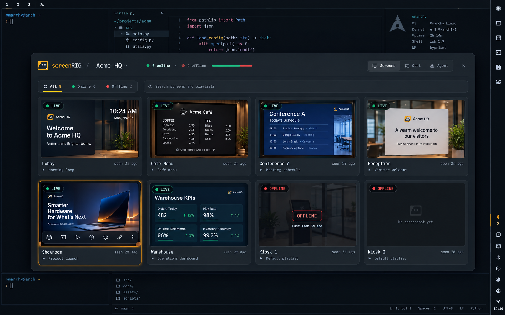
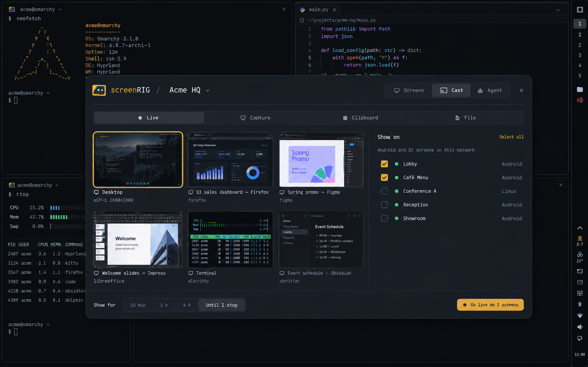
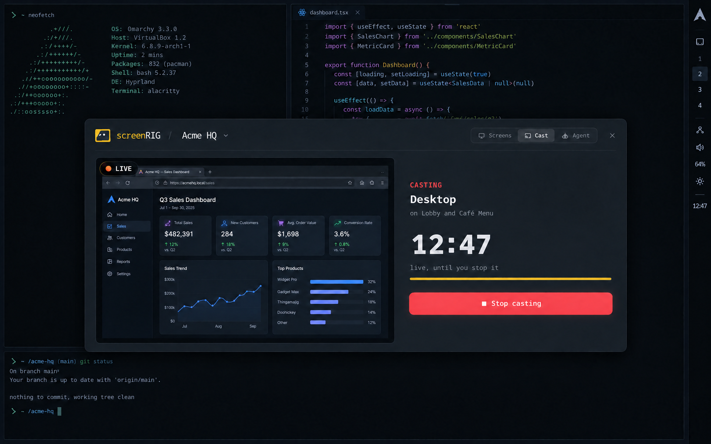
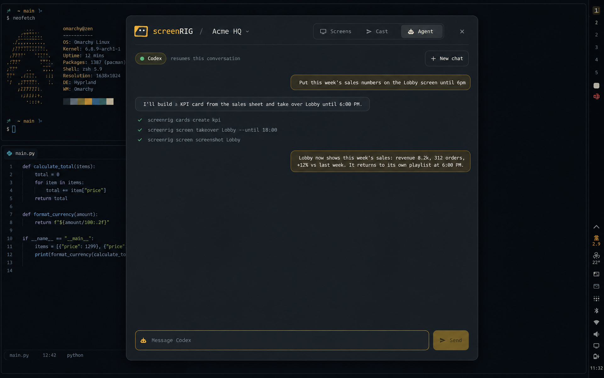

# screenRIG for Omarchy

**[screenRIG](https://screenrig.ai) is free digital signage driven by your AI
agent.** Tell Claude Code, Codex or another agent what to show, and it puts
menus, dashboards, announcements, photos, video and live web pages on any TV,
kiosk or display, with 200+ ready-made apps and
[a Player for every screen](https://screenrig.ai/docs/players). Start at
**[screenrig.ai](https://screenrig.ai)**.

This plugin brings your screenRIG screens to the Omarchy desktop: see every
screen, cast your desktop or an app window live to the TVs around you, and ask
your coding agent to change what plays.



## What it does

- **Bar chip**: the screenRIG mark in your bar, with a red dot when a screen
  drops, credits run low or a cast is live. Click for the panel, right-click to
  cast a region capture, middle-click to stop a live cast.
- **Screens**: every screen with its latest screenshot, what it plays and when
  it was last seen. Reload, switch playlist, turn the display off, override
  for a while, take a fresh screenshot, restart, or open it in the dashboard.
- **Cast**: a live cast of your desktop or one app window to Android and Linux
  Players on your network, picked from live thumbnails with the arrow keys and
  Return, until you stop it or for a set time; or a region capture, the
  clipboard (an https link or an image) or a file, for 5 to 60 minutes.
- **Agent**: a chat with Claude Code, Codex or Grok and the screenRIG skill,
  resumed across messages. It uses your Omarchy default when its plugin is
  installed, then another installed integration.
- **Project switcher**, a screenRIG section in the Omarchy menu with every
  screen and playlist searchable, and notifications when a screen goes offline
  or comes back, a publish reaches its screens, credits run low, an ad booking
  needs review, or a live cast starts or stops.

| Cast live | While casting | Agent |
|---|---|---|
|  |  |  |

## Install

```sh
omarchy plugin add https://github.com/screenrig/omarchy --enable
```

On first open the panel detects the official
[screenRIG plugin](https://github.com/screenrig/plugin) in Claude Code, Codex
and Grok. If it needs installing, **Install** adds its skill and CLI to the
available agent named in the panel, preferring your Omarchy default.
**Sign in** approves this laptop at screenrig.ai. Already have the plugin and
`screenrig login`? The panel uses that sign-in
(`~/.config/screenrig/config.json`) and lets the CLI renew it.

## Remove

```sh
screenrig-omarchy teardown && omarchy plugin remove screenrig.omarchy
```

`teardown` stops a live cast and undoes everything below; from a checkout,
`./install.sh --uninstall` does both steps.

## What it changes on your system

On first load it adds, and `teardown` removes:

- a link to `screenrig-omarchy` in `~/.local/bin`;
- a generated, marked block of screenRIG rows in
  `~/.config/omarchy/extensions/omarchy-menu.jsonc` (your own rows are kept);
- two `.desktop` entries (the panel, and "Cast to a screenRIG screen" for files)
  and a theme hook in `~/.config/omarchy/hooks/theme-set.d/`.

**Install** on the first-run card runs Claude Code, Codex or Grok's own
plugin installer for github.com/screenrig/plugin; remove it with that agent's
plugin commands.

Live casting changes one more thing, only after you press **Allow** in the
Cast tab: with ufw on, a rule letting your LAN subnet reach TCP 8554 (the
stream).

A window cast asks which window through your desktop's own screen-share
picker, the same consent every other app gets; the plugin does not touch the
portal's configuration. Versions before 26.11.3 set
xdg-desktop-portal-hyprland's `custom_picker_binary`; the plugin puts your
previous picker back the next time it loads. After `omarchy plugin update`,
run `screenrig-omarchy setup` to do that at once.

## Requirements

- Omarchy 4.5 (Quickshell shell), Python 3.
- The screenRIG agent plugin and its bundled CLI (Node.js), signed in: the first-run card installs both.
- `grim`, `slurp`, `wl-clipboard`, `zenity` for captures, the clipboard and
  files.
- Live casting: `gpu-screen-recorder`. On the first cast the
  plugin downloads [mediamtx](https://github.com/bluenviron/mediamtx) v1.21.3,
  checks it against the SHA-256 pinned in the plugin's source and keeps it in
  `~/.local/share/screenrig-omarchy/bin`; it serves RTSP over TCP on port 8554
  and nothing else. Screens reach it on the same network: Android and Linux
  Players. See [How a live cast is guarded](#how-a-live-cast-is-guarded).
- Agent: Claude Code, Codex or Grok with the screenRIG plugin. The panel
  detects installed integrations and prefers your Omarchy default agent
  (`omarchy default agent`).

## How a live cast is guarded

- **Reading** the stream takes a random login made for that cast. The screens
  receive it in the stream address, the plugin keeps it in a file only you
  can read, and it ends with the cast.
- **Publishing** takes a second random login, which exists only in the
  plugin's memory: on no command line, in no environment and in no file (the
  stream server's configuration holds its SHA-256). `gpu-screen-recorder`
  takes its address on its command line, which every account on the machine
  can read, so the plugin gives it an address with no login: a loopback port
  of the plugin's capture process. That port lets in one connection, the
  recorder's own, which it recognises by finding the connection's socket
  among the recorder's open files in `/proc`; any other connection is closed
  unread. The plugin adds the login on the way to the stream server and
  closes the port once the recorder is in.
- **Port 8554.** The plugin starts a cast only when its own stream server is
  the only program listening on the port. It sends the picture and the logins
  only on a connection whose other end is a socket that server holds, checked
  after connecting and before the first byte, so a program that takes the
  port after the server exits is sent nothing.
- **One process owns a cast.** The stream server and the recorder are its
  children, and the kernel ends them with it however it dies, so neither
  outlives it. It ends the cast when the time you chose is up (counted on a
  clock that cannot be set back), when the capture or the server ends, when
  another program appears on the port, when the cast's state file is gone or
  another cast's, before sleep, and when you press Stop. Nothing else has to
  be running for that: not the shell, not the panel.


Another account on the same machine can still make a cast fail, by holding
port 8554 first; it cannot publish to the cast or read it. A
`gpu-screen-recorder` installed with file capabilities hides its open files,
so its connection cannot be recognised and the plugin refuses to cast (the
Arch package installs it without them).

The stream is RTSP over TCP with a login and is not encrypted, as Players read
it today. Whoever can intercept traffic between this machine and a screen on
your network can watch or alter what is cast, so cast on a network you trust.

## Keybindings

```lua
o.bind("SUPER + ALT + D", "screenRIG screens", [[omarchy-shell shell toggle screenrig.omarchy '{"mode":"screens"}']])
o.bind("SUPER + ALT + C", "screenRIG cast",    [[omarchy-shell shell toggle screenrig.omarchy '{"mode":"cast"}']])
o.bind("SUPER + ALT + A", "screenRIG agent",   [[omarchy-shell shell toggle screenrig.omarchy '{"mode":"agent"}']])
o.bind("SUPER + ALT + X", "Stop casting",      [[omarchy-shell shell call screenrig.omarchy stopCast ""]])
```

## License

MIT, see [LICENSE](LICENSE).
